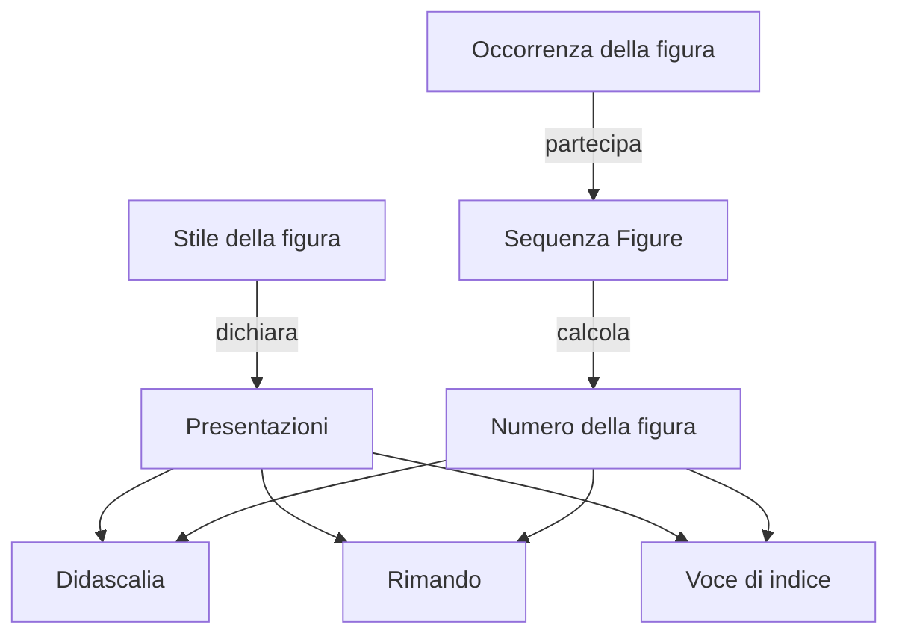

# Modello unico di oggetti, relazioni e formule

Documento di progetto, 11 novembre 2026. **Da discutere prima di implementare.** Il codice del programma non è stato modificato.

## 0. Principio, decisioni ed evidenze

**Lo stile dice come; l’occorrenza dice chi e conserva il contenuto dell’autore; il resto si calcola.** Si mantengono i sei concetti di OGGETTI-EDITORIALI: stile, occorrenza, aggancio, sequenza (nome UI: Lists), presentazione e collocazione. Le decisioni editoriali del 7 novembre prevalgono sulle proposte precedenti dello stesso appunto: continuazione come interruttore sul capoverso con lo stesso stile, ripartenze/riprese puntuali, scelta dell’oggetto con etichetta modificabile, rimando cancellato «(??)», conservazione delle componenti delle note fuse e dei loro punti d’origine.

Evidenze distinte: **letto** nei sorgenti e nei test, **provato nel modello Alloy** entro limiti dichiarati, **proposto** per il nuovo sistema. Gli esempi descrivono una grammatica di progetto, non una sintassi già implementata. I risultati Alloy non provano l’applicazione.

Fonti locali lette: `CLAUDE.md`, memoria del progetto, `Appunti/OGGETTI-EDITORIALI.md`, `Appunti/SCHEMA-MODELLO.md`, `Appunti/Alloy/RISULTATI.md`, `Appunti/RIASSUNTO-RESIDUO.md`, i sorgenti e i test citati sotto. Alcuni commenti e lo schema precedono la pulizia del formato 18: oggi non si leggono formati 1–17 o regole del documento.

Vincoli fissi: Core Text, AAT prioritario, PDF di sistema, niente docx/HarfBuzz/Typst come motore, Graphite soltanto se installata nel sistema e richiesta. Nessuna modifica dei font. Identificatori invariati: `local.griffr`, `local.griffr.document`, `.grx`. UI in inglese. Annulla/Ripeti, bozze concorrenti, eredità, importazione e provenienza restano requisiti del modello.

Per la discussione, le sezioni 3, 7 e 10 raccolgono rispettivamente la proposta, i casi osservabili e le decisioni ancora aperte. Le tabelle di conversione e l’appendice servono alla verifica tecnica.

## 1. Inventario attuale

I percorsi sono relativi alla radice di GRIFFR. L’inventario comprende i concetti editoriali e i relativi dati; i tipi di supporto per cache o geometria non diventano automaticamente oggetti editoriali.

### 1.1 Oggetti e identità

| File | Costrutto | Dati e identità attuali |
|---|---|---|
| `Sources/Typesetting/Document.swift` | `Document` | Base tipografica `formulaBase`, pagina, tracking, margini ottici, limite espansione glifi, lingua, sillabazione, stili, Liste, stili flottanti/tabelle, tipi di pagina, ruoli font, numerazione pagine, blocchi, sezioni; nessun ID documentale. |
| stesso | `Section`, `SectionMark`, `SectionPageTypes`, `SectionStart` | ID stringa salvato; ruolo, titolo, blocchi, sottosezioni, blocchi successivi (`afterward`), avvio continuous/newPage/oddPage, pagine normale/pari/prima, numerazione. Mark è una proiezione nel testo piatto con profondità. |
| stesso | `Block`, `FlatParagraph` | Paragrafo/tabella e proiezione con sezione, cella e ritorno dalla sezione; nessuna nuova identità. |
| stesso | `Paragraph`, `ParagraphStyle` | Nome stile, valori locali, appartenenza elenco, inline, distanza d’apertura, tenuta, filetti. Allineamento natural/left/right/center/justified, rientri, spazi, interlinea aggiunta, moltiplicatore altezza, livello titolo. Nessun ID salvato. |
| `DocumentStore.swift` | `ParagraphID`, `resegment` | UInt64 in memoria. Normalmente l’ID segue il primo carattere superstite; se manca, il segmento con più caratteri del vecchio paragrafo. ID unici, trattamento del paragrafo finale vuoto. Gli snapshot di Annulla li ripristinano; il file non li salva. |
| `Document.swift` | `Inline`, `TextRun` | Testo/flottante/immagine. Tratto con resa, stili parola/carattere, eccezioni per proprietà e campo. Intervalli senza ID. |
| stesso | `FloatingObject` | Stile, paragrafi `[[TextRun]]`, immagine facoltativa, aggancio a un carattere. Nessun ID. Note/figure/testatine usano il contenitore comune; i paragrafi interni non hanno tutto `Paragraph`. |
| stesso | `ImageObject` | Source embedded(Data)/linked(String), larghezza, altezza; nessun ID. |
| stesso | `Table`, `TableRow`, `TableCell`, `CellMark` | Solo la tabella ha ID salvato. Righe/celle posizionali; colonne non autonome. Tabella: righe, headerRows, stile, valori, stile flottante, didascalia. Cella: paragrafi, valori, columnSpan/rowSpan/isCovered. Mark: ID tabella, riga, colonna, headerRows, stile/valori tabella/cella, flottante, span; riga negativa per didascalia. |
| stesso | `Field` | Unico caso formula(FieldFormula), segnaposto nel tratto. Nessun ID; scorciatoie Swift per pagina/pagine/sezione. |
| `Lists.swift` | `ListItem`, `ListDefinition`, `ListNumbering`, `ListNumberer`, `ListMark` | Appartenenza sul paragrafo; definizioni per nome; stato di conteggio temporaneo. Nessuna identità di voce o di istanza riprendibile. |
| `Styles.swift` | `NamedStyle`, `StyleSheet`, `StyleTarget` | Nome, target paragraph/word/character, basedOn per nome, valori, formule, variabili, heading, writes. Foglio con stili, selezioni, riutilizzabili. |
| `Document.swift`, `TableAppearance.swift` | `FloatStyle`, `PageType`, `TableStyle` | Definizioni per nome, senza ID. PageType ha setup; TableStyle ha TableValues. |
| `Rules.swift` | `WordSelection`, `TextRule`, `BodyText` | Selezione con UUID; regole tecniche transitorie; parole/frasi come intervalli, non oggetti salvati. |
| `ReusableFormula*.swift` | `ReusableFormula`, `FormulaParameter`, `StyleVariable` | UUID di definizioni, parametri, variabili; firma ed espressione; variabili pure nello stile. |
| `HeadingComposition.swift`, `WrittenResult.swift` | Testata e risultati scritti | Definizioni nello stile, parti senza ID (indice nell’array); presentazioni calcolate. |
| `PageLayout.swift`, `ParagraphRules.swift` | `DocumentLayout`, `LaidOutPage`, `PlacedLine`, `PlacedMarker`, `PlacedHeadingPart`, `PlacedImage`, `PlacedFill`, `PlacedParagraphRule`, `PageStartPlacement`, `TextMap` | Pagine, righe, segni, testate, immagini, fondi, filetti, collocazioni e mappa sorgente/mostrato; risultati temporanei. |
| `Sources/WordProcessor/InspectorPanel.swift` | `InspectedObject` | Altro catalogo: document, section, page, table, cell, paragraph, line, word, character. |

### 1.2 Predicati, proprietà e argomenti

`StylePredicates.swift`: predicati `set/add/subtract`. Le **27 proprietà** sono elencate singolarmente nella tabella 4.1. I **14 argomenti**: font(FontRole), length(Double,LengthUnit), alignment, language(String?), family(String), face(String), color(String?), smallCaps, hyphenates(Bool), pageStart(PageStartSpacing), text(String), styleName(String?), boolean(Bool), integer(Int).

`FontRole.swift`: regular/italic/bold/boldItalic combinano tondo/corsivo e normale/grassetto; aggiungere/togliere combina tratti, non numeri. Corpo >0, spaziature ≥0, rientri con segno, numeri finiti. Alignment/language/family/face/color/smallCaps/hyphenates, direttive e applyStyle ammettono solo set. Le altre quantità ammettono anche add/subtract. Vedove/orfane e righe seguenti 1–9; righe precedenti seguono `LineKeeping.previousRange`; livello titolo validato 0–99, con 0 che lo toglie.

`StyleFormula.swift`: UUID locale, operazione, when, target, binding facoltativo a FormulaExpression. Condizioni, bersagli parziali e applyStyle richiedono oggi uno stile di paragrafo. Direttive: paragrafo intero, nessuna condizione, salvo pageStartSpacing con any/firstOnPage e senza misura.

### 1.3 Bersagli, condizioni e fatti

Tutti in `Rules.swift` e `StyleConditions.swift`.

| Categoria | Catalogo esatto |
|---|---|
| Target | firstLetter, firstWords(Int), selection(UUID), firstSentence, words(WordPattern), firstLines(Int), lastLine, paragraph |
| WordPattern | capitals (almeno due lettere tutte maiuscole), romanNumerals maiuscoli, numbers (sole cifre), listed([String]) esatto e sensibile alle maiuscole |
| WordSelection.Source | words/capitals/numbers; indice positivo da 1; UUID e nome |
| Position | any, firstAfter(String), sequenceStart, firstOnPage |
| StyleCondition | posizione AND una misura facoltativa; niente albero booleano |
| Misure | lines, words, lastLineFill, hyphens |
| Confronti | equal/eq, less/lt, lessOrEqual/le, greater/gt, greaterOrEqual/ge |
| NaturalFacts | lineCount, wordCount, lastLineFill, hyphenatedLines; fill confrontato come percentuale arrotondata |
| ParagraphContext | stile corrente/precedente, inizio sequenza, primo sulla pagina facoltativo |

FirstLetter include la punteggiatura d’apertura prevista dal selettore; firstWords conserva quella associata; firstSentence usa la segmentazione di sistema. FirstLines/lastLine dipendono dalla composizione. SequenceStart è il fatto strutturale prodotto da `SectionEditing.opensSequence`: inizio del documento o apertura di una sezione con avvio non continuo. È distinto dal primo membro di una Lista. FirstAfter esclude l’inizio di sequenza. Il commento «finché non ci sono sezioni» è superato.

Le misure e firstOnPage leggono la **composizione naturale prima dei relativi effetti**, per decisione editoriale esistente. È superato anche il commento che assegna precedenza ai valori manuali: oggi le formule contestuali vincono salvo eccezioni `rules-off` per proprietà.

### 1.4 Campi e formule riutilizzabili

| File | Catalogo e contratto |
|---|---|
| `FieldFormula.swift` | Origini position/document; soggetti position/document/page/section; passi containingPage, containingSection(role); letture number/title/pageCount. Solo position offre passi: al massimo un passo valido. Destinazione implicita scrivi qui. |
| stesso | FieldContext conserva pageNumber/pageCount stringhe e sezioni ruolo/titolo/numero? senza ID. Si legge l’ultima sezione del ruolo, la più interna. Value restituisce String, vuota su assenza o catena invalida. |
| `ReusableFormula.swift` | Valori number(Double), length(Double in pt), boolean(Bool), tre tipi corrispondenti. Expression: constant, parameter(UUID), add, call(UUID,args per parametro), variable(UUID). Nessun testo/oggetto/contesto. |
| `ReusableFormulaIntegration.swift`, altri `ReusableFormula*.swift` | JSON/base64, riferimenti/rimappatura, sostituzione variabili, binding alle proprietà compatibili. Variabili non ammesse nelle definizioni riutilizzabili; profondità variabili <64, chiamate <128, nodi/passaggi <10000; diagnosi di duplicati, riferimenti/argomenti, tipi, cicli e numeri non finiti. |

### 1.5 Presentazioni e Liste

`HeadingPart`, in `HeadingComposition.swift`, ha sette casi:

| Parte | Dati |
|---|---|
| label | text, style?, alignment, minHeight? |
| number | prefix, style?, alignment, minHeight? |
| title | alignment?, minHeight? |
| numberBeside | prefix, style?, side, gap |
| result | FieldFormula, prefix, style?, alignment, minHeight? |
| rule | thickness, length?, alignment |
| space | lunghezza |

HeadingAlignment: left/center/right/outside/inside; numero accanto senza center. Al massimo un titolo e un numberBeside; senza title il titolo segue le parti impilate. NumberBeside si posa sulla prima riga e restringe il titolo. Number/numberBeside sopprimono il segno della Lista; result non è riconosciuto come numero da showsNumber. Numero/risultato vuoto sopprime la fascia. Il titolo resta testo dell’autore.

`WrittenResult.swift`: formula, place before/after, prefix, suffix, style?. Risultato vuoto sopprime i testi fissi; questi non ammettono ritorni a capo. Testo calcolato sulle righe del paragrafo, escluso dal cursore, con TextMap. Oggi il percorso riguarda il corpo principale, non uniformemente celle, note e didascalie.

`Lists.swift`: ListItem ha marker, level 1–9, listName?, textIndent?, markerPosition?. Negli elenchi nominati marker non conta; negli anonimi è un simbolo qualsiasi o schema `1/a/A/i/I` con prefisso/suffisso. ListNumbering gestisce livelli, interruzioni e cambi di segno.

ListDefinition: name, counter, prefix, suffix, start, end?, parent?, continues, showsParent, overflow, textIndent?, markerPosition?, numbersSections?. Counter: decimal/lowerLetter/upperLetter/lowerRoman/upperRoman/asterisks/symbols/none. Parent: list(name)/page/section(role). Overflow: ask/restart/double/numbers; restart qui significa esaurimento della serie, non ripartenza puntuale. ListMark: text, value, needsOverflowChoice. ListNumberer conta per nome e riceve eventi di pagina/sezione/lista superiore e interruzioni. Misure risolte da voce, Lista, valori iniziali; segno allineato a destra e distanza minima. Numeri mai salvati.

### 1.6 Flottanti e proprietà oltre StyleProperty

`FloatStyle`, in `Document.swift`:

| Gruppo | Proprietà/casi |
|---|---|
| Collocazione | placement: pageFoot/documentEnd/outerMargin/figure/pageHead/pageBottom |
| Numero/richiamo | listName?, reference superscript/plain/none |
| Separatore/spazi | showsRule, ruleLength?, spaceAbove, spaceBelow |
| Corpo | canSplit, contentStyle?, heading?, startsOnNewPage |
| Figure | positions here/top/bottom/page (h/t/b/p), exactlyHere, ignoresLimits, caption below/above/none |
| Ripetizione | pages all/odd/even/first, edgeDistance? |

PageLayout usa numeratori nominati separati per corpo e note: una nota non interrompe l’elenco del corpo. La collisione marginale attuale può conservare due note alla quota dell’aggancio con avviso; non si presuppone uno spostamento automatico già funzionante.

| File/tipo | Ulteriori proprietà da conservare |
|---|---|
| `Styles.swift/StyleValues` | fontName, family, italic, bold, size, features, variations, opticalSize, color, verticalPosition, decorations, graphite, smallCaps, language, hyphenates; alignment, firstLineIndent/leftIndent/rightIndent, spaceBefore/spaceAfter, lineSpacing, lineHeightMultiple; listName, opensSection, nextStyle, outlineLevel, openingDistance, pageStartSpacing, keeping, rules. |
| `Document.swift/CharacterStyle` | fontName, size, features, language, variations, prefersVariableFont, fontRole, opticalSize, hyphenates, color, verticalPosition, decorations, graphite, smallCaps. |
| stesso | VerticalPosition: shift, scale, usesFontGlyphs. LineDecoration: under/through/over; solid/double/dotted/dashed/wavy; offset, thickness?, color?, skipsDescenders. |
| `ParagraphRules.swift` | Filetti top/bottom/left/right con offset, start, end, thickness. Non sono TextRule. |
| `LineKeeping.swift` | withNext, together, linesAtEnd, linesAtStart, nextLines, previousLines, facoltativi prima della risoluzione. |
| `TableAppearance.swift` | TableValues: rules grid/threeRules/horizontal/frame/none, ruleWidth, padding top/right/bottom/left, verticalAlignment top/middle/bottom, background. CellValues: quattro bordi none/rule(width), background, verticalAlignment, padding. |
| `PageLayout.swift/PageSetup` | paperSize, margini top/bottom/left/right, facing; specchio calcolato. LengthUnit mm/cm/in/pt/pc; parser misure già con aritmetica, conversione in pt. |

### 1.7 Ispettore, UI, fasi, file

`Inspection.swift`: InspectorProperty = family/face/size/smallCaps/color/verticalPosition/decorations/shaping/language/hyphenates/alignment/leftIndent/rightIndent/firstLineIndent/spaceBefore/spaceAfter/lineHeightMultiple/lineSpacing/list/openingDistance/keepWithNext/keepTogether/orphanLines/widowLines/nextLines/previousLines. ValueSource = own/style(name)/document/rule(summary). InspectedValue: valore, ereditato, origine, misto, influenza. RuleInfluence: regole, proprietario, manuale sospeso, valore restituito dall’eccezione; vince l’ultima regola.

Nil significa ereditare; stringhe vuote, raccolte vuote o modalità off possono significare cancellazione esplicita. Si preserva il contratto per proprietà.

`ActionComposer.swift`, `ComposerActions.swift`: azioni/variabili/condizioni sulla bozza dello stesso foglio autorevole, movimenti nella stessa fase, protezione delle variabili usate. `StyleComposer.swift/ComposerBoardModel`: base della bozza, campione, validazione, controllo conflitti e Applica transazionale. `FieldFormulaEditor.swift`: costruttore distinto di catene, riusato da heading/writes; contesto d’esempio, non valore dell’occorrenza reale.

`StyleConditions.swift/StyleFormulaPhase`: ordine enum base, placement, textContext, composition, assignment, paragraphCreation. NextStyle è paragraphCreation; opensSection/outlineLevel assignment; distanze e tenute placement; runtime con misure o target di riga composition; altre runtime textContext; resto base. L’ordine UI non è una sequenza di sei passate dell’impaginatore.

`StyleRuleCompilation.swift`: espansione riutilizzabili, antenati prima dei discendenti, ordine formule conservato. Genera regole e stili tecnici con chiave utilizzatore/dichiarante/UUID locale; nessuno di essi si salva. ApplyStyle ammette una resa senza altre regole contestuali. Cache della compilazione distinta dal foglio.

`PageLayout.layout`: composizione iniziale, fino a tre ripetizioni per note numerate per pagina e tre per totale pagine, senza avviso finale di mancata convergenza. Il rilevamento del totale considera campi e testate, non direttamente WrittenResult: **candidato a prova di regressione, non difetto riprodotto**.

`DocumentFormat.swift`: version=18, oldestReadableVersion=18. XML rigoroso; elementi/attributi ignoti rifiutati. Formula nello stile, catena del campo a punti più ruolo separato, JSON/base64 per diversi payload (riutilizzabili, variabili, binding, heading, writes). `<rules>` contiene selezioni/riutilizzabili, non `<rule>`. Nessuna identità paragrafo salvata.

## 2. Critica e precedenti

1. Un target sa trovare la quinta parola, un campo sa trovare la sezione, ma le due capacità non si compongono. Il problema non è l’assenza del selettore della quinta parola: manca una relazione generale riutilizzabile.
2. Number del campo è testo già formattato, mentre i riutilizzabili conoscono numeri senza contesto: impossibile verificare la parità del capitolo o incrementarne il numero.
3. ApplyStyle è un verbo trattato come proprietà; opensSection e nextStyle appartengono agli eventi dell’editor. Non sono tutte proprietà di resa.
4. Identità persistenti, ParagraphID, offset e nomi sono meccanismi diversi. Un campo non può citare una figura scelta e ParagraphID cambia alla riapertura.
5. Le condizioni sono chiuse e le viste naturali implicite. Leggere sempre il layout finale cambierebbe la decisione editoriale sulle misure naturali.
6. Numero in testata e segno di Lista si coordinano riconoscendo il caso enum; un result equivalente non è riconosciuto. Serve una politica esplicita della presentazione del segno.
7. Creare una nota nel layout senza un contratto di persistenza duplicherebbe oggetti o perderebbe contenuto quando manca l’aggancio.
8. Le politiche ereditarie differiscono: formule accumulate, heading sostituito dalla prima definizione non nulla (anche vuota), writes sostituito dalla prima raccolta non vuota. Non vanno uniformate perdendo comportamento.

Casi oggi non esprimibili: stile della quinta parola condizionato dal capitolo; nota relativa sospesa con contenuto proprio; sezione → suo inizio → pagina; rimando a figura specifica; indice delle figure; ripresa di un elenco scelto; confronto di conteggi nelle celle; riutilizzabile che riceve una figura e ne compone il numero.

Precedenti consultati come idee:

- Jeffrey H. Kingston, *The Design and Implementation of the Lout Document Formatting Language*, 1993, [PDF](https://cs.brown.edu/courses/cs196-9/lout-design.pdf): galley con origine distinta dal bersaglio ricettivo, accettazione/rifiuto/sospensione. Si riprendono destinazioni e vincoli; non il motore. Il percorso locale al manuale expert citato negli appunti non era disponibile.
- Typst, [Styling](https://typst.app/docs/reference/styling/) e [Context](https://typst.app/docs/reference/context/): separare impostazione, selezione, presentazione e lettura contestuale; iterazioni limitate con avviso. Non si adotta scripting generale o Typst come motore.
- Adobe InDesign, [nested styles](https://helpx.adobe.com/indesign/desktop/format-and-style-text/text-styles/created-nested-styles.html), [GREP](https://helpx.adobe.com/indesign/desktop/format-and-style-text/text-styles/create-grep-styles.html), [object styles](https://helpx.adobe.com/indesign/desktop/add-graphics-and-media/manage-object-styles/define-and-apply-object-styles.html), [anchored objects](https://helpx.adobe.com/indesign/desktop/add-graphics-and-media/transform-and-arrange-objects/about-anchored-objects.html): selezione ordinata/per schema, resa degli oggetti e distinzione aggancio/collocazione. Non risolvono automaticamente le identità di GRIFFR.

## 3. Modello unificato proposto

### 3.1 Catalogo unico, identità e provenienza

Un catalogo in Typesetting descrive tipi di oggetto, proprietà, relazioni e azioni. Ogni proprietà ha nome stabile, tipo, unità, sorgente, possibilità di modifica, politica di eredità e disponibilità per fase. La UI consulta lo stesso catalogo del validatore; non inventa altre liste di bersagli. Il catalogo rimane tipizzato e implementato nel programma: «condizioni aperte» significa composizione di letture ed espressioni, non esecuzione di codice arbitrario o caricamento di plugin dal documento.

| Tipo proposto | Identità | Proprietà leggibili | Dati modificabili e origine |
|---|---|---|---|
| Document | Salvata | Definizioni, flusso principale, sezioni, numero pagine nella vista composta | Impostazioni attuali, libreria definizioni; autore |
| StyleDefinition, ListDefinition, FormulaDefinition, SelectionDefinition, PlacementDefinition, TableStyleDefinition, PageTypeDefinition | Salvata, indipendente dal nome | Nome, firma/target, base, dichiarazioni, parametri, politiche | Definizioni dell’autore; ID delle definizioni esistenti conservati o qualificati |
| TextFlow | Salvata | Paragrafi, ordine locale, proprietario | Testo principale, corpo nota, cella, didascalia; editing |
| Section | Salvata | Ruolo, titolo, sotto-sezioni, inizio/fine, numero, pagine occupate | Titolo/ruolo/avvio/tipi pagina/numerazione; autore e eventi strutturali |
| Paragraph | Salvata mediante segni nel testo | Testo dell’autore, stile assegnato, proprietà risolte, voce, parole/frasi, sezione, frammenti | Testo, stile, eccezioni, continuazione, direttive locali; autore |
| Table, TableRow, TableColumn, TableCell | Salvata | Relazioni strutturali, valori propri/risolti, testo, span, dimensioni composte | Struttura, valori, flussi; operazioni tabella. Per le celle unite si conservano le origini necessarie alla separazione, da formalizzare |
| ListItem | Salvata e distinta dal primo paragrafo | Paragrafi membri, sequenza, livello, numero | Appartenenza/continuazione e scelte locali; editing, non conteggio del layout |
| SequenceInstance e SequenceSegment | Istanza salvata quando scelta o ripresa; segmenti impliciti ricostruibili | Lista di definizione, membri ordinati, punto di ripresa, numero di ciascuno | Restart/resume/start dell’occorrenza. I reset automatici pagina/sezione sono risultati, non nuove identità salvate ad ogni layout |
| FloatingObject, Note, Figure, Image, Field | Salvata per occorrenza | Contenuto, aggancio, stile, numero, presentazioni e frammenti | Contenuto, riferimento alla risorsa, formula del campo, scelte proprie. Note/Figure specializzano il contenitore comune per capacità, non per motori separati |
| Anchor e OriginBoundary | Salvata se è un riferimento durevole | Supporto testuale, affinità, ordine tra segni coincidenti, origine del confine | Operazioni dell’editor; non offset assoluti come unica verità |
| RelativeAnchor | Definizione salvata; bersaglio calcolato | Proprietario, ricerca, risultato presente/assente | Ricerca dell’autore; stato sospeso calcolato |
| Word, Sentence, Character, TextRange | Calcolata dalla revisione del testo | Contenuto, posizione nel flusso, appartenenza, resa risolta | Resa mediante contributi sugli intervalli; il testo si modifica attraverso l’editor. Character significa grafema; gli offset UTF-16 restano un dettaglio d’integrazione con AppKit/Core Text |
| PresentationDefinition e PresentationPart | ID salvato della definizione/parte | Espressione, oggetto rappresentato, collocazione, stile, politica segno | Definizioni e disposizione, non copia del contenuto dell’oggetto |
| PresentationInstance, Page, ColumnFragment, Line, ObjectFragment | Calcolata, riferimenti limitati a revisione/composizione | Testo rappresentato, origine, pagina, geometria, avvisi | Nessuna scrittura diretta di numeri o rettangoli; si cambiano vincoli/definizioni |
| NoteComponent e raggruppamento attivo | Componenti d’origine persistenti; raggruppamento calcolato/riconciliato | Testo per origine, ordine, nota visibile comune | Testo dell’autore e confini ricordati. Non si distruggono le componenti quando due note appaiono come una |

Promuovere una parola a bersaglio durevole significa creare un Anchor/TextRange persistente, non salvare un UUID per ogni parola. Una riga composta non si può promuovere come se fosse testo stabile: si conserva una ricerca relativa o un riferimento al suo contenuto sorgente.

Gli ID sono locali al documento; un riferimento è (documento, tipo, ID) o una forma locale equivalente. Non si introduce ora il collegamento fra file. Le sezioni e le tabelle mantengono gli ID esistenti. Etichette distinte dagli ID, uniche nell’ambito di selezione del documento: servono alla ricerca e alla scelta, poi il riferimento conserva l’ID. Rinominare non cambia il bersaglio. Un oggetto cancellato non viene sostituito dal prossimo che riceve la stessa etichetta.

Ogni valore letto distingue `own`, `inherited`, `input`, `resolved`, `natural`, `composed`. Input è lo stato ricevuto dal contributo corrente, utile per add/subtract; non una variabile mutabile dell’autore. Le altre viste hanno dipendenze e disponibilità dichiarate. Un valore assente può essere Optional<T>; l’esito di valutazione è separatamente Ready(T), Pending(dipendenze) o Invalid(diagnosi). Oggetto cancellato, vuoto legittimo, sospensione e formula invalida non diventano indiscriminatamente la stessa stringa.

La relazione fra identità e rappresentazioni, nel caso della figura:



### 3.2 Relazioni e grammatica comune

Il grafo ha contenimento strutturale aciclico, riferimenti e appartenenze. Le relazioni di layout sono distinte: un paragrafo può avere frammenti su più pagine. Si evita un singolo «contiene» che confonda albero editoriale e geometria.

| Relazione | Tipo/cardinalità e ordine |
|---|---|
| children(kind), parent(kind), ancestor(kind,predicate) | Contenimento strutturale; ancestor può essere più interno/esterno esplicito; risultato facoltativo se manca |
| words/sentences/characters(source) | Collezione ordinata; source distingue testo dell’autore e contenuto rappresentato; i selettori storici conservano il proprio dominio |
| previous/next(within) | Stesso flusso/voce/sequenza esplicitati; non ordine globale implicito fra corpo e note |
| first/last/nth(n)/take(n), filter(predicate) | Operatori comuni sulle collezioni; nth da 1, assenza se fuori intervallo, non clamp silenzioso |
| reference(id), labeled(label) | Il secondo serve a risolvere o scegliere; il file conserva il primo dopo la scelta. Una ricerca dinamica per etichetta, se introdotta, è un’altra operazione esplicita |
| item, paragraphs, sequence, members, parentItem | Appartenenze di voce e numerazione; i membri sono occorrenze, non presentazioni |
| anchor, owner, sourceObject, presentations | Aggancio, proprietario dei dati e oggetto rappresentato sono ruoli differenti |
| fragments(view), startPosition, endPosition, pageOf(position), occupiedPages | Relazioni della composizione; mai «pagina del paragrafo» ambiguo |
| matching(pattern), namedSelection(id) | Selettori di testo riutilizzabili, comprese le semantiche storiche; GREP futuro con limiti di costo e motore esplicito |

La notazione leggibile seguente è un modo di mostrare l’AST tipizzato. Le parole fra virgolette nei riferimenti indicano nomi UI, risolti a ID. Non si implementa un parser testuale obbligatorio per l’autore.

```text
Path<T> := root | relation(Path, arguments) | filter(Path, BoolExpr)
         | nth(Path, Integer) | take(Path, Integer) | reference(ObjectID)
Expr<T> := literal(T) | parameter(ID) | variable(ID) | Path<T>
         | read(Path, PropertyID, View) | call(DefinitionID, arguments)
         | arithmetic | comparison | and | or | not | exists | if | format
         | content(parts) | map(collection, expression) | count(collection)
Declaration := id + ownerScope + target(Path) + when(Expr<Bool>) + Action
```

Root esplicite: `document`, `owner` (occorrenza che usa lo stile), `target` (elemento scelto), `sourceObject` (oggetto rappresentato), `here` (punto della presentazione) e parametri. Una funzione riutilizzabile riceve oggetto/contesto come parametro tipizzato o dichiara una capacità contestuale esplicita; non eredita variabili casuali dal chiamante. Le vecchie funzioni restano pure e indipendenti dal layout, con identica valutazione.

Esempio: `owner.words(author).nth(5)` può essere target di stile o aggancio relativo. `here.pageOfPosition.number` scrive la pagina della presentazione. `sourceObject.anchor.pageOfPosition.number` legge invece la pagina dell’oggetto rappresentato: essenziale per un rimando o una testatina.

### 3.3 Tipi, numerazione ed espressioni

Tipi minimi: Bool, Integer, Number, Length, Ratio, Text, Content, ObjectRef<T>, Optional<T>, OrderedCollection<T>, valori tipografici enumerati e NumberingValue. Le operazioni sono dimensionali: Length+Length, Number×Length, confronti fra quantità compatibili; sommare una lunghezza a un numero è errore. Si conserva il limite di espansione esistente e si aggiungono limiti a ricerche, collezioni e costo delle regex, senza cicli scritti dall’autore.

NumberingValue conserva ordinale, componenti gerarchiche e significato della formattazione. `ordinal` è un intero utilizzabile nei calcoli; `components` mantiene «3.2»; `format(value,definition)` produce testo con simboli, prefisso/suffisso e overflow. Le letture migrate di FieldFormula.number usano la resa attuale, non una conversione numerica che perda parentesi o romani. La numerazione logica non si salva; una scelta di overflow o restart è invece un dato dell’autore. `counter.none` può non mostrare testo pur avendo una posizione logica.

Il servizio di numerazione è comune, ma conserva partizioni e interruzioni: corpo, note, pagine, figli di una Lista e sezioni non vengono compressi in un contatore globale. I reset per pagina dipendono dalla composizione; gli ordini strutturali non dipendenti dalle pagine si calcolano prima. L’ordine dei flottanti deriva dall’aggancio, non dal momento in cui una presentazione viene disegnata.

Le variabili sono espressioni immutabili, con dipendenze per ID e cache per revisione/occorrenza/vista. Non sono celle di memoria o assegnazioni procedurali. Una condizione è Expr<Bool>, con and/or/not e confronti generali; su Optional serve exists o un caso esplicito. Pending rinvia il giudizio e Invalid produce una diagnosi: non si seleziona un bersaglio sulla base di un falso artificiale.

### 3.4 Verbi e dichiaratività

| Azione | Contratto |
|---|---|
| Set(property,value) | Sostituisce un contributo ammesso; valore e unità verificati |
| Add/Subtract(property,value) | Combina con input secondo l’algebra della proprietà: misure o tratti, mai coercizione universale |
| ApplyStyle(style,rendering) | Aggiunge la resa dello stile al bersaglio; mantiene inizialmente il limite attuale dei trattamenti senza regole contestuali ricorsive |
| AssignStyle(style) | Operazione persistente dell’editor, distinta da ApplyStyle; non si esegue ad ogni layout |
| Create(kind,slot,defaults) | Dichiara l’esistenza associata a una chiave stabile; il layout non aggiunge oggetti al documento |
| Place(presentation,destination,constraints) | Descrive priorità ammesse, distanze, allineamenti, suddivisione, ripetizione, gestione collisioni |
| Write(content,presentation) | Produce testo/contenuto calcolato senza inserirlo nel testo dell’autore |
| JoinList(definition,policy) | Dichiara appartenenza e politica normale; restart/resume puntuali sono sull’occorrenza |
| ConfigureEditor(event,intent) | Dichiarazione per assegnazione/Invio; apertura sezione, livello strutturale e stile successivo valutati nella transazione appropriata |

Le proprietà appartengono a namespace editoriali (`character`, `paragraph`, `structure`, `placement`, `editor`), non a un’enumerazione piatta di effetti equivalenti. Le azioni non sono funzioni riutilizzabili con effetti: le funzioni calcolano valori; le dichiarazioni definiscono effetti ammessi.

Ordine dei contributi: antenati prima dei discendenti, valori espliciti e formule nell’ordine compatibile attuale, poi contributi contestuali nella fase prevista. Ogni passata riparte dallo stesso ingresso; «aggiungi 2 pt» non si accumula a ogni tentativo. Per raccolte/presentazioni si salvano politiche esplicite inherit/replace/extend e soppressione per ID; la conversione adotta quelle storiche, non nuovi default retroattivi.

### 3.5 Creazione, agganci e modifiche del testo

Una dichiarazione che crea una nota possiede uno slot con chiave `(occorrenza, definizione dichiarante, ID locale dichiarazione)`. La definizione dichiarante qualifica UUID locali che oggi possono coincidere in due stili. L’eredità riusa l’identità della dichiarazione originaria; duplicare esplicitamente una dichiarazione crea una nuova identità. Per futuri generatori con più risultati occorrerà anche l’identità del membro, mai l’indice transitorio di una parola.

Prima dell’editing, una nota vuota può essere una proiezione virtuale deterministica; al primo contenuto o riferimento durevole viene materializzata nel registro persistente. Se viene materializzata durante applicazione dello stile, avviene nella transazione dell’editor, una volta sola. Entrambe le strategie devono dare la stessa identità logica dello slot. Il layout e l’anteprima non modificano il documento. Le transazioni riconciliano il registro dopo le modifiche; non rivalutano ricorsivamente altre azioni editoriali senza evento.

Quinta parola assente: slot e contenuto rimangono, presentazione sospesa; ritorno del bersaglio: riuso dello slot. Rimozione della regola o cambio stile: raccomandazione di conservare contenuto inattivo accessibile, senza cancellazione implicita. Il punto finale va deciso nella sezione 10.

I segni fissi seguono il testo e conservano affinità/ordine quando coalescono; eliminando il supporto migrano al successore, compreso il terminatore di flusso. La ricerca relativa rimane relativa al suo proprietario. Spezzare prima della quinta parola lascia la nota originaria al primo paragrafo, sospesa; il nuovo ha il suo slot vuoto. Unendo, si presenta il testo delle componenti in una nota sola, con avviso e confini d’origine persistenti. Spezzando davanti al testo originario del secondo, la sua componente segue quel testo. Le regole complete devono essere verificate nel modello del testo: gli esperimenti astratti non bastano.

Copiando si assegnano nuovi ID agli oggetti copiati e si rimappano soltanto i riferimenti interni alla copia; quelli esterni mantengono il bersaglio. Spostando/tagliando all’interno del documento si conserva l’identità mediante un’operazione editoriale esplicita; l’eventuale riuso di un contenuto di clipboard dopo il primo incolla deve generare una copia. ID non duplicati nel documento. Per incolla fra documenti, importazione delle definizioni e identità delle occorrenze sono due operazioni distinte. È una politica proposta da formalizzare, non un comportamento provato.

### 3.6 Fasi, disponibilità e convergenza

| Ambito | Letture e risultati ammessi |
|---|---|
| Risoluzione base | Dati dell’autore, eredità, espressioni indipendenti dal layout; nessuna lettura della propria proprietà finale per definirla |
| Contesto strutturale/testuale | Relazioni e selettori del testo, sequenze non dipendenti dalle pagine |
| Collocazione | Vincoli di apertura/tenuta/destinazione e proprietà contestuali disponibili |
| Composizione naturale | Misure del paragrafo prima dei relativi effetti; adattatore iniziale conserva esattamente il procedimento attuale |
| Effetti e presentazioni | Risultati contestuali, trattamento di righe/parole, numerazione per pagina, contenuto generato; dipendenze esplicite |
| Eventi editor | Assegnazione, Invio, creazione persistente e cambi strutturali; transazioni Annulla, mai mutate da layout o PDF |

Queste sono responsabilità, non sei passate cronologiche fisse. Il catalogo dichiara `availableWhen`, la vista richiesta e l’effetto ammesso; il validatore deriva le dipendenze e la UI mostra la fase risultante. Vietati cicli di funzioni/variabili, proprietà che si definiscono leggendo il proprio finale e creazione strutturale dipendente dalla pagina composta. Le dipendenze ricorsive di applicazione stili restano rifiutate nella prima migrazione.

Le dipendenze di layout ammesse dal motore (numero pagine, numero della nota per pagina, riferimenti alla pagina dell’oggetto) vengono rivalutate in tentativi limitati. In ogni tentativo i fatti naturali sono misurati come oggi; non si trasformano in condizioni sul risultato finale dei propri effetti. Una nuova lettura finale che cambia la geometria deve dichiarare il ricorso alla convergenza; non si introduce sotto il nome di una lettura naturale.

La firma di stabilità comprende assegnazioni di pagina rilevanti, numeri, testi generati e vincoli modificati, non soltanto il totale delle pagine. Rilevare stati ripetuti aiuta a diagnosticare oscillazioni. Limite configurato dal programma, ultimo risultato coerente del tentativo e avviso con oggetti/dichiarazioni coinvolti. La terminazione a un limite è garantibile; la convergenza universale non lo è. Si devono conservare i link PDF e le origini dei risultati dello stesso tentativo.

### 3.7 Eredità, bozze, importazione, ispettore

Il foglio autorevole resta uno. Un controllo semplice è una vista dello stesso AST e sostituisce un’espressione complessa solo mediante azione esplicita, senza congelarne automaticamente il risultato. ID di parti e dichiarazioni permettono modifiche mirate.

Una bozza ha revisione di partenza e un ambiente di valutazione separato. Nessun oggetto materializzato o risultato della bozza entra nel documento fino ad Applica. In caso di modifica concorrente si mantiene almeno il rifiuto/ricaricamento attuale; una fusione automatica è un progetto separato. Applica, cambi di testo, riconciliazione e dati creati formano una transazione; Ripeti ripristina gli stessi ID. Le cache usano identità/revisione/contesto, non soltanto nomi.

L’importazione attraversa tutte le dipendenze del grafo: base dello stile, trattamenti, selezioni, variabili/chiamate, Liste/parent, stili dei contenuti e delle presentazioni, tipi di pagina e collocazioni. I conflitti hanno scelte esplicite e rimappatura completa. I riferimenti a occorrenze del documento sorgente non si importano come se fossero definizioni: vanno risolti o segnalati. Da controllare il percorso attuale delle dipendenze degli stili citati in heading/writes: rilievo dalla lettura, non regressione riprodotta.

L’ispettore riceve una traccia: oggetto, proprietà/vista, valore d’ingresso/uscita, dichiarazione e stile d’origine, condizione e letture usate, precedenze, manuale sospeso, eccezione attiva, stato Pending/Invalid/sospeso. La traccia estende ValueSource/RuleInfluence; conserva la precedenza attuale dei contestuali sopra i manuali salvo rules-off. Nessun secondo motore di spiegazione che ricostruisca il risultato dai soli nomi.

## 4. Corrispondenza completa con i costrutti attuali

Questa è una mappa di **traduzione semantica**, non una riscrittura mediante nomi somiglianti. In prima battuta l’adattatore può proiettare i nodi tradotti sulle strutture tecniche attuali. Ogni limitazione annotata resta valida per le dichiarazioni convertite; ampliare i casi ammessi è lavoro successivo.

### 4.1 Tutte le proprietà formula e i loro argomenti

`S` = Set; `A/T` = Add/Subtract. La fase contestuale di una proprietà di resa deriva dal target e dalla condizione; la tabella indica l’ambito della proprietà, non forza tutte le sue formule nella fase base.

| StyleProperty | Argomento attuale | Traduzione | Predicati/particolarità |
|---|---|---|---|
| font | font(role) | character.fontRole | S/A/T, composizione tratti e risolutore attuale; conservazione peso nel caso previsto |
| size | length | character.size | S/A/T, >0 |
| spaceBefore | length | paragraph.spaceBefore | S/A/T, ≥0 |
| spaceAfter | length | paragraph.spaceAfter | S/A/T, ≥0 |
| firstLineIndent | length | paragraph.firstLineIndent | S/A/T, con segno |
| leftIndent | length | paragraph.leftIndent | S/A/T, con segno |
| rightIndent | length | paragraph.rightIndent | S/A/T, con segno |
| lineSpacing | length | paragraph.lineSpacing | S/A/T, ≥0; distinto da lineHeightMultiple |
| alignment | alignment | paragraph.alignment | S, enum attuale |
| language | language | character.language | S, assenza/cancellazione preservate; portata di parola o paragrafo |
| family | family | character.family | S; risoluzione font esistente |
| face | face | character.face | S; faccia precisa, non ruolo relativo |
| color | color | character.color | S; nil e RGB attuali |
| smallCaps | smallCaps | character.smallCaps | S; off/lowercase/uppercase/all (`SmallCaps.swift`) |
| hyphenates | hyphenates | character.hyphenates | S; lingua/portata preservate |
| pageStartSpacing | pageStart | placement.pageStartSpacing | S; off o distanza; applicazione di inizio pagina e condizione ammessa come oggi |
| openingDistance | length | placement.openingDistance | S; significato nel contesto di apertura |
| opensSection | text | ConfigureEditor(assignment, openSection(role)) | S tradotto in intento; ruolo vuoto toglie l’intento |
| nextStyle | styleName | ConfigureEditor(return, useStyle(ref?)) | S tradotto in intento; disabilitazione esplicita distinta da eredità |
| outlineLevel | integer | structure.outlineLevel | S; assegnazione; zero rimuove livello |
| applyStyle | styleName | ApplyStyle(styleID, rendering) | S tradotto in verbo; stesso limite di compatibilità target e trattamento |
| keepWithNext | boolean | placement.keep.withNext | S; false esplicito |
| keepTogether | boolean | placement.keep.together | S; false esplicito |
| orphanLines | integer | placement.keep.linesAtEnd | S; 1–9, fondo pagina |
| widowLines | integer | placement.keep.linesAtStart | S; 1–9, cima seguente |
| nextLines | integer | placement.keep.nextLines | S; 1–9, dipende dalla tenuta col seguente |
| previousLines | integer | placement.keep.previousLines | S; 0–9, zero disabilita |

Per ogni operazione si conservano identità, unità dichiarata per l’editor, validazione del risultato e valore ricevuto. Per binding si traduce l’espressione attiva; la costante di appoggio resta metadato di migrazione/controllo, non un secondo risultato. Binding length/pageStart → Length, integer → conversione esatta Number→Integer (finito, intero, 0–99, poi limite della proprietà), boolean/hyphenates → Bool. Il distacco dal binding può fissare il risultato solo su richiesta, come oggi.

### 4.2 Bersagli e condizioni

`P` è il paragrafo proprietario; i nomi `legacy…` indicano il contratto del selettore da conservare, riusando segmentazione/punteggiatura. Non sono un secondo sistema di formule: sono relazioni e letture con semantica specifica nel catalogo.

| Attuale | Espressione nuova equivalente |
|---|---|
| paragraph | `P` intero, con contributi di paragrafo o del suo testo secondo la proprietà |
| firstLetter | `P.legacyOpeningLetterRange`, prima lettera/cifra e punteggiatura prevista |
| firstWords(n) | `P.legacyFirstWordRange(n)`; non n intervalli disgiunti che perdano la punteggiatura |
| selection(id) | `P.namedSelection(id)` |
| WordSelection words/capitals/numbers + index | `nth(filter(P.words(legacyBody), matcher), index)` con mappa di intervallo del selettore attuale |
| firstSentence | `P.sentences(legacyBody).first.range` con confini attuali |
| words(capitals/romanNumerals/numbers/listed) | `filter(P.words(legacyBody), matches(pattern))`; stessa classificazione per ciascuno dei quattro casi, lista esatta sensibile alle maiuscole |
| firstLines(n) | `P.lines(legacyLineTreatment).take(n).sourceRanges` |
| lastLine | `P.lines(legacyLineTreatment).last.sourceRange` |
| any | `true` |
| firstAfter(styleName) | `P.previous(in: sameFlow).assignedStyle == ref(styleID) and not P.opensStructuralSequence`, con la nozione di precedente del contesto attuale |
| sequenceStart | `P.opensStructuralSequence` (da SectionEditing), distinta da `P.item.isFirstInSequence` |
| firstOnPage | `P.isFirstOnPage(natural)` |
| lines | `P.lineCount(natural)` |
| words | `P.wordCount(natural, legacyBody)` |
| lastLineFill | `round(100 × P.lastLineFill(natural))`, stesso limite della misura attuale |
| hyphens | `P.hyphenatedLineCount(natural)` |
| eq/lt/le/gt/ge | `== / < / ≤ / > / ≥` sul valore letto e la soglia finita non negativa |
| posizione + misura? | `and(positionExpr, comparisonExpr)`; misura assente = `true` |

I trattamenti di riga conservano anche il meccanismo con cui il motore attuale sceglie gli intervalli mentre compone, non si presume che basti applicare un colore alle righe finali. La vista di compatibilità è eliminabile solo con prova di equivalenza sulle interruzioni e sulla sillabazione.

### 4.3 Campi, riutilizzabili e presentazioni

| Costrutto attuale | Traduzione |
|---|---|
| position.page-containing.number.write-here | `Write(formatLegacy(here.pageOfPosition.number), here)` |
| position.section-containing.title.write-here + role | `Write(here.innermostSection(role).title, here)` |
| position.section-containing.number.write-here + role | `Write(formatLegacy(here.innermostSection(role).number), here)` |
| document.page-count.write-here | `Write(decimal(document.pageCount), here)` |
| FieldContext | Radici e relazioni di contesto; `here` usa il punto di ancoraggio/risoluzione attuale, non l’inizio del paragrafo al posto del carattere del campo |
| FieldFormula assente/risultato vuoto | Politica di presentazione compatibile `omit`, diversa dal nuovo rimando con «(??)» e avviso; conservare anche la resa provvisoria durante la composizione |
| FormulaValue number/length/boolean | Letterali Number/Length(pt)/Bool |
| constant / parameter / variable | `literal / parameter(id) / variable(styleID,id)` |
| add | `+` con due operandi dello stesso tipo numerico/Length e controllo finitezza |
| call | `call(formulaID,{parameterID: expr})`, argomenti esatti per firma |
| FormulaParameter / ReusableFormula / StyleVariable | Firme e definizioni pure, ID/nome/tipo/espressione preservati; campo di applicazione lessicale |
| HeadingPart.label | `Write(literal(text))` in fascia con stile/allineamento/altezza minima |
| HeadingPart.number | `Write(prefix + formatLegacy(sourceObject.section.number))` se presente, fascia condizionale; occupa la presentazione del segno |
| HeadingPart.title | Slot del paragrafo originale, non una copia; allineamento e altezza minima propri opzionali |
| HeadingPart.numberBeside | Stessa lettura del numero, `Place` accanto alla prima riga, lato e gap; riserva larghezza solo se presente, occupa il segno |
| HeadingPart.result | `Write(prefix + expr)` se non vuoto, fascia condizionale con stile/allineamento/altezza minima; non occupa automaticamente il segno nella conversione |
| HeadingPart.rule | Parte di contenuto filetto con spessore, lunghezza (nil → specchio), allineamento |
| HeadingPart.space | Parte di spazio verticale con lunghezza |
| HeadingComposition | Raccolta ordinata di parti con ID; posizione del titolo e numero accanto come sopra. Lati inside/outside risolti su pagina, left/center/right diretti |
| WrittenResult.before / after | `Write` nel flusso rappresentato a inizio/fine, prefisso e suffisso condizionati a risultato non vuoto; stile o resa adiacente; TextMap/cursore e limitazioni attuali conservati |

Nelle testate la posizione da cui leggere mantiene il titolo e la sezione che apre. Il numero delle parti `number/numberBeside` si riferisce alla sezione aperta, non genericamente alla prima sezione di un ruolo. Nessuna duplicazione della voce o del numero per la ripetizione di una testatina.

### 4.4 Dati e politiche non espressi da StyleFormula

| Costrutti attuali | Rappresentazione nuova e garanzia |
|---|---|
| NamedStyle, StyleSheet, StyleTarget | Definizioni per ID e capacità paragraph/word/character; base per riferimento; stesso ambito; nuove capacità di tabella/flottante si aggiungono dopo parità |
| StyleValues e CharacterStyle (§1.6) | Valori tipizzati per proprietà, inclusi tratti font, asse, feature, optical, fallback, Graphite, maiuscoletto, colore, lingua, sillabazione, posizione e decorazioni. Conservare false/off/empty/nil, sostituzioni per gruppo e ordine delle operazioni font; inizialmente delega ai risolutori attuali |
| ParagraphStyle, LineKeeping, ParagraphRules | Valori locali o ereditati di paragrafo/collocazione; filetti come decorazioni ancorate al paragrafo; distinguere interlinea aggiunta/moltiplicatore, valori propri ereditati ed espliciti |
| ListItem marker, level, listName, textIndent, markerPosition | Voce con appartenenza e posizione del segno; anonimo con schema per livello, nominato per ID; misure locali > definizione > default |
| ListDefinition name, counter, prefix, suffix, start/end | Definizione di numerazione, formattazione del segno, intervallo; conservare tutti i contatori e simboli, inclusi none e romani fuori intervallo |
| ListDefinition parent/continues/showsParent/overflow | Politica di partizione/reset, ripresa automatica, componenti gerarchiche e risposta all’esaurimento. Mantiene ask/restart/double/numbers. Parent list/page/section distinto dalla ripresa manuale |
| ListDefinition textIndent/markerPosition/numbersSections | Default della presentazione della voce e appartenenza delle sezioni per ruolo |
| ListNumbering/ListNumberer/ListMark | Numeratore comune con profili legacy anonimo/nominato e partizioni corpo/note; risultato tipizzato più testo e richiesta di scelta overflow. Migrazione non reinventa istanze permanenti per tutti gli elenchi automatici |
| FloatStyle placement, positions, exactlyHere, ignoresLimits, canSplit | Destinazioni e vincoli di Place; conservare precedenza h/t/b/p, limiti e regole di scissione |
| FloatStyle listName, reference | Appartenenza e presentazione del richiamo sup/plain/none |
| FloatStyle showsRule, ruleLength, spaceAbove, spaceBelow | Parti e misure del separatore e del corpo |
| FloatStyle contentStyle, heading, startsOnNewPage | Resa del contenuto, titolo del gruppo e vincolo di apertura |
| FloatStyle caption, pages, edgeDistance | Presentazioni della didascalia sopra/sotto/nessuna e ripetizione all/odd/even/first con distanza dal bordo |
| FloatingObject, ImageObject | Oggetti persistenti con flussi, aggancio fisso iniziale, contenuto, stile e risorsa embedded/linked con dimensioni; copie di byte e percorsi inalterati |
| Document, Section, PageSetup, PageType | Radice con impostazioni attuali, titoli e struttura, tipi pagina per sezione e numero pagina con stessa ereditarietà; proprietà risolte dei margini, ordine di afterward e ritorni preservati |
| Table, TableRow, TableCell, CellMark, TableStyle, TableValues, CellValues | Struttura salvata e coordinate calcolate, spans/coperture, headerRows ripetute, didascalia, resa e collocazione. Conservare schema bordi, spessori, padding, allineamenti e fondi. Una riga di testata ripetuta non è una nuova riga strutturale |
| TextRun e attributi locali | Flusso e intervalli con stessi contenuti, stili e attributi; segnaposto dei campi e flottanti, stessa mappa selezione/risultato |
| ParagraphID / resegment | Indice di lavoro con corrispondenza a segni persistenti; comportamento storico senza riferimenti preservato; nuove operazioni d’identità passano prima per Alloy |
| TextRule e stili tecnici | Solo adattatore transitorio di valutazione; mai un oggetto salvato. Owner e declaration distinti nella traccia |
| Eccezioni rules-off / Inspection | Sospensione per proprietà/intervallo e traccia di vincitore, contributi superati, origine, manuale restituito e valore misto |
| Eredità formule | Estensione ordinata: antenati → discendenti, valori → formule per strato, fasi preservate |
| Heading nil / definito anche vuoto | `inherit / replace(parts)`; anche replace([]) sopprime l’ereditato |
| Writes [] / non vuoto | `inherit / replace(nonempty)`; una futura soppressione esplicita è nuova capacità |
| ComposerBoardModel e gesti editor | Una bozza, validazione, revisione, Applica/Annulla/Ripeti; stessa granularità delle transazioni |

## 5. File e compatibilità con il formato 18

### 5.1 Schema proposto

Si conserva l’XML `.grx` e la struttura dei contenuti già funzionante. Si aggiungono ID dei proprietari e delle occorrenze, riferimenti per ID, segni persistenti e dichiarazioni con AST tipizzato. Proposta: **19** come prima versione che scrive dati nuovi, da assegnare quando quella tappa è pronta; `oldestReadableVersion = 18` resta. Le tappe successive alzano la versione solo quando scrivono costrutti nuovi. Evitare una nuova DSL di stringhe da interpretare e l’accoppiamento al `Codable` sintetizzato di enum Swift.

Gli esempi seguenti sono frammenti di schema, con ID brevi solo per leggibilità. I nomi degli elementi sono proposti, non il formato già implementato. La stessa grammatica di nodi expression/path viene usata in `<target>`, `<when>`, `<value>`, `<variable>`, corpo funzione e presentazione.

```xml
<document version="19" id="doc-1">
  <styles>
    <style id="style-body" name="Body" target="paragraph">
      <declaration id="formula-1" action="set" property="character.color">
        <target><nth index="5"><words source="author"><owner/></words></nth></target>
        <when><compare op="ge"><count><words source="author"><owner/></words></count>
          <literal type="integer" value="5"/></compare></when>
        <value><literal type="color" value="#183C2D"/></value>
      </declaration>
    </style>
  </styles>
  <!-- Altri dati della pagina e delle definizioni come previsti dallo schema. -->
  <p id="p-17" style-id="style-body">Text <field id="field-2">
    <write destination="here" missing="warn-placeholder">
      <format pattern="sequence"><read property="number"><ref type="figure" id="fig-1"/></read></format>
    </write>
  </field>.</p>
  <!-- L’occorrenza fig-1 è definita nel contenuto del documento. -->
</document>
```

Un caso di nota relativa richiede due record concettuali, ciascuno con responsabilità diversa:

```xml
<declaration id="note-rule" action="create" kind="note">
  <target><owner/></target>
  <relative-anchor><nth index="5"><words source="author"><owner/></words></nth></relative-anchor>
  <use-placement ref="outer-comment"/>
</declaration>
<generated-note id="note-7" owner="p-17" declaring-style="style-body" declaration="note-rule">
  <component id="piece-7" origin-boundary="boundary-7"><p id="p-note-7">Author text.</p></component>
</generated-note>
```

Gli agganci fissi e i confini d’origine sono segni inline associati ai flussi, non coordinate globali del documento. Esempio concettuale: `<anchor id="a-1" affinity="downstream"/>` e `<origin-boundary id="boundary-7" active="off"/>`. L’ordine serializzato dei segni coincidenti è significativo. I confini devono poter stare anche nel capoverso vuoto; la codifica del terminatore richiede una prova di round trip. Per una sequenza esplicita si salvano definizione e istanza, assegnazioni/riprese per ID e `continue-previous-item` sul capoverso. Una sezione di presentazione con `inherit/replace/extend` conserva l’ordine delle parti e i loro ID.

Nodi indispensabili: letterali tipizzati con unità, radici, riferimenti, relazioni e selettori, lettura con vista, confronti/operatori, argomenti per ID, definizioni e firme, azioni e relativi vincoli, politiche di eredità, fallimenti e placeholder. I nuovi identificatori di proprietà/operazione sono stabili e versionati; validazione di tipi, cardinalità e fase in lettura. Nomi UI, numeri formattati temporanei, pagine, righe, geometrie, cache, stili tecnici e avvisi calcolati non si salvano come verità del documento.

### 5.2 Lettura del 18 senza perdita

1. **Decodifica con il lettore 18 conservato.** Stessa validazione XML, lettura dei payload json-v1 e delle espressioni a punti; non tentare di interpretare il 18 con il nuovo schema permissivo. Il solo wrapper `<rules>` continua a essere letto come libreria.
2. **Costruzione dei proprietari.** Conservare ID esistenti di sezioni/tabelle, UUID delle selezioni, funzioni, parametri, variabili e formule nel loro ambito. Assegnare ID a definizioni, flussi e occorrenze che ne sono prive. Si possono generare deterministicamente durante la conversione da una chiave locale del documento e percorso sorgente; diventano durevoli col primo salvataggio nuovo. Nessuna corrispondenza esterna viene dedotta da un offset o da un nome.
3. **Risoluzione dei riferimenti in un secondo passaggio.** Nomi di stili/Liste/tipi/placement → ID nella categoria corretta; distinguere nome vuoto di cancellazione, assenza e default. Non scambiare stili diversi con lo stesso UUID locale della formula. Non sostituire riferimenti rotti con un oggetto arbitrario. I default impliciti del 18 devono essere materializzati semanticamente, non persi perché omessi nell’XML.
4. **Traduzione con la tabella 4.** Conservare valori storici e loro ordine, misure naturali, regole sui segni, stile dei risultati, le diverse politiche di eredità. Per elenchi automatici mantenere la politica legacy anziché indovinare le intenzioni di ripresa. Campi trasformati in Write con letture e fallback compatibili. Non reintrodurre `<rule>`, `.wpx` o formati 1–17.
5. **Verifica e scrittura.** Validare il modello convertito, tenendo distinti diagnosi di file invalido, riferimento a oggetto cancellato e risultato ancora indisponibile. Aprire non riscrive il file; il salvataggio esplicito scrive il nuovo schema quando il writer è pronto. Un’app che legge solo il 18 rifiuterà la versione nuova. Raccomandazione: avviso e opzione di salvare una copia al primo passaggio; nessun downgrade implicito. Durante le tappe interne senza nuovi dati, mantenere writer 18.

Criterio di equivalenza: testo dell’autore e valori propri/ereditati, ordine delle azioni, contatori e segni, posizione dei campi, stile e geometria, comportamento di editing e PDF, con i medesimi font disponibili. Non basta uguaglianza dell’XML o del numero di pagine. Prove `18 → modello → 19 → modello`, e confronto con la composizione 18 sui documenti campione: `prova-bacheca-stili.grx`, `prova-condizioni-comportamenti.grx`, `prova-apertura-pagina.grx`, `prova-sottrai.grx`, `prova-stili-formule.grx`, `prova-compositore.grx`, `prova-formule-riutilizzabili.grx`, `annapurna-sil-tabelle.grx`, `Campione-font.grx` se i font richiesti sono disponibili. Controllare la versione dei campioni prima di congelarli come fixture; non convertire in-place gli originali dell’autore. Aggiungere casi minimi sintetici per copertura dei costrutti assenti dai campioni.

## 6. Compositore comune

Un solo editor di dichiarazioni ed espressioni. Il punto d’ingresso decide quali radici e destinazioni sono disponibili; la grammatica, la validazione, il controllo dei riferimenti e l’editor dei valori sono gli stessi. La bacheca conserva la libreria di azioni, la definizione e l’anteprima. Le fasi appaiono come raggruppamenti derivati, con ordine modificabile dove ha effetto dichiarativo. Non si trascina un’azione oltre una fase per costringere il motore a eseguirla prima.

Schizzi testuali. Le etichette dell’interfaccia sono in inglese; il layout grafico non è vincolato da questi esempi.

```text
Style Composer · Body

Actions                 Definition                         Preview
Set                     Text context                       Document selection
Apply Style              Target  This paragraph › Words    Paragraph 17
Write                            › Fifth
Create Note              When    Chapter › Number › Is odd
Place                             AND Words › Count ≥ 5
Join List                Apply Style  Emphasis

Variables                Inherited from  Base Body

Cancel    Reload    Apply
```

L’editor di `Target` e quello di `Read` sono lo stesso costruttore a passi. Dopo «Words» si possono scegliere `First`, `Nth`, `Filter`, `Count` secondo il tipo richiesto. `When` apre un albero leggibile di condizioni con `All`, `Any`, `Not`. Le proprietà incompatibili o non ancora disponibili nella fase non sono selezionabili; un eventuale errore sulla bozza si spiega accanto alla dichiarazione. I controlli semplici continuano a operare sul medesimo nodo o chiedono conferma per sostituire il calcolo.

```text
Field · Figure reference

Write here
  Read from   Referenced object   [Choose…]
              Figure: Study area
  Read        Number
  Format      As in sequence
  If missing  (??) + warning

Preview  Figure 3
Cancel    Apply
```

`Choose…` apre una selezione nel documento o in elenco e propone un’etichetta leggibile modificabile. Un riferimento salvato resta legato all’oggetto; una ricerca per quinta parola, invece, è dichiaratamente relativa. Un campo semplice continua a poter nascere da una voce pronta, come `Page Number`.

```text
Heading · Chapter

Parts                          Selected part
Number beside                  Write   Section opened here › Number
Title                          Side    Outside
Rule                           Gap     4 mm
Space                          Style   Chapter Number
Result                         Marker  Replaces list marker

Preview   Sample / Document selection
Cancel    Apply
```

`Title` è lo slot dell’originale; `Result` apre lo stesso editor del campo. Particolari di impaginazione, come `Outside` e `Min. height`, appartengono a Place. `Marker` rende esplicita la scelta che oggi dipende da HeadingPart. La bozza applica una sola transazione a stili/campi/testate, con controlli di conflitto equivalenti a quelli esistenti. Campione e selezione del documento devono essere distinguibili; la prima versione può continuare a mostrare soltanto `Sample` dove non dispone di un contesto reale.

```text
Inspector · Note

Object      Comment
Status      Suspended
Anchor      Paragraph › Fifth word
Content     Edit Content…
Source      Body › Create Note
```

L’ispettore usa il catalogo per scegliere oggetto e proprietà, e la traccia del motore per mostrare valore proprio, ereditato o prodotto dalla dichiarazione. Pannelli essenziali; diagnosi dettagliate nei dettagli dell’oggetto, senza aggiungere testo didascalico permanente alla bacheca.

## 7. Casi di prova espressi nel modello

Le righe di notazione indicano dichiarazioni o dati di occorrenza; non rappresentano un programma che modifica in sequenza lo stato. Ogni caso precisa il risultato osservabile.

| Caso editoriale | Dichiarazioni e dati | Prova di accettazione |
|---|---|---|
| 1. Esempio su più capoversi | `style Example → JoinList(Examples)`; secondo e terzo capoverso: `continue-previous-item=true`, stile Example; rimando `Write(format(ref(item).number),here)` | Un solo segno sul primo, una voce e tre paragrafi nell’ispettore. Sposta il gruppo: numero aggiornato, rimando alla stessa voce. Dividi/unisci e Annulla senza duplicare membri. |
| 2. Stili diversi nella stessa Lista | `Example` e `Counterexample → JoinList(Examples)`; `Place(Write(format(item.number)), markerSlot)` con resa distinta per stile | Alternanza 1, 2, 3 anche se cambia la resa. I due stili non creano contatori distinti. Un richiamo di nota nel mezzo non interrompe l’elenco. |
| 3. Elenchi indipendenti e ripresa | A e B usano la stessa definizione; inizio B `restart(start:1,newInstance:B)`; terzo segmento `resume(ref(A))` | A: 1,2; B: 1,2; ripresa A: 3,4; cambi a B non alterano la progressione A. Preservare la politica ordinaria continues per elenchi comuni ed esempi. |
| 4. Nota da piede a margine | Nota `ref(n)` con contenuto, aggancio, appartenenza; `Place(body(n), pageFoot)` → `Place(body(n), outerMargin)` | Stessa identità, contenuto, richiamo e sequenza. Il numero è invariato se il contesto di numerazione resta lo stesso; può cambiare con ripartenza per pagina se l’aggancio cambia pagina. |
| 5. Quinta parola scompare | `Create(Note, slot(owner,rule), anchor=owner.words(author).nth(5))`; `Place(note.body,outerMargin)` | A quattro parole sospesa con testo accessibile; a cinque la stessa nota ritorna una sola volta. Distinguere da aggancio fisso a parola spostata. Provare divisione prima della quinta, fusione con avviso, riscrittura a capo e separazione dei pezzi originari. |
| 6. Figura, didascalia, rimandi, indice | `Figure → JoinList(Figures)`; `Write("Figure " + format(sourceObject.number) + authorCaption, belowImage)`; due `Write(format(ref(fig).number),here)`; indice `map(document.figures, entry(title,number,startPage))` | Un solo membro di Figures e un numero concorde in quattro presentazioni; spostare/rinominare conserva il riferimento. Cancellare figura: «(??)» e avviso; ricreare stessa etichetta non ripara il vecchio riferimento. |
| 7. Risultato che cambia pagina | `Write(decimal(document.pageCount), here)` in campo, testata e risultato nel paragrafo; nota con `JoinList(NotesPerPage)` | Caso 9→10 pagine o spostamento di una nota con totale invariato. Ogni consumatore dichiara dipendenze; risultato stabile oppure avviso dopo limite. Un ciclo provocato intenzionalmente termina e identifica la dichiarazione. Il caso WrittenResult isolato verifica il rilievo della sezione 1.7. |

Casi nuovi e prove trasversali:

| Espressione | Controllo |
|---|---|
| `ApplyStyle(Emphasis) on owner.words(author).nth(5) when chapter.number.ordinal % 2 == 1 and count(owner.words(author)) >= 5` | Lettura numerica e bersaglio condiviso; capitolo mancante gestito con exists/alternativa esplicita. Un campo può leggere `.text` della medesima parola. |
| `Write(format(ref(section).startPosition.pageOfPosition.number), here)` | Catena di più passi; pagina d’inizio diversa dalla pagina del campo e dalla pagina finale della sezione. |
| `Write(if count(ref(cellA).paragraphs) > count(ref(cellB).paragraphs) then "A" else "B", here)` | Confronto di letture strutturali, celle vuote e ID dopo riordinamento; non confronta coordinate posizionali obsolete. |
| `FigureLabel(figure: Figure) = "Figure " + format(figure.number)` | Funzione pura con parametro oggetto; usata in didascalia, rimando e indice, rinomina senza perdita. |
| `JoinList(Subexamples, parent=owner.item.parentItem)`; `Write(format(number.components), markerSlot)` | (7a), (7b), reset al passo del padre; nessun parsing del testo «(7)». |
| `Place(Write(section.title), pageHead where page.isEven)` e `Write(format(here.pageOfPosition.number),here)` nella stessa testatina | Distinzione fra sezione rappresentata e pagina di presentazione. Ripetere la testatina non incrementa contatori di sezioni. |
| `Set(size, input.size + 2 pt)` e condizione su `natural.lineCount` | Due impaginazioni non accumulano i 2 pt. La condizione non cambia significato quando l’effetto altera il numero di righe. La stessa espressione con `resolved.size` autoreferenziale viene diagnosticata. |
| Bozza A cambia una dichiarazione; bozza B la modifica e applica | A non sovrascrive B; Applica non materializza oggetti di una bozza respinta; Annulla/Ripeti preservano contenuto e ID. |
| Import di stile con funzione, variabile, selezione, heading e writes | Chiusura completa delle dipendenze, rimappa senza confondere stesso nome/UUID locale; provenienza corretta dopo import, salvataggio e riapertura. |
| Conversione con `rules-off`, heading vuoto e writes vuoto | Eccezione conservata per proprietà, heading vuoto sopprime, writes vuoto eredita, distinzione fra valore locale sospeso e restituito. |

## 8. Alloy: risultati e lavoro necessario prima del codice d’identità

Sono stati eseguiti tre modelli temporanei con **Alloy 6.2.0, Glucose**. I sorgenti sono in appendice A per riproducibilità senza aggiungere altri file al commit. Per gli esperimenti precedenti sul testo e l’anteprima, vedi `Appunti/Alloy/RISULTATI.md`.

| Modello e limite | Risultati osservati | Interpretazione e limiti |
|---|---|---|
| `generation.als`, al più 5 elementi per firma, 5 stati espliciti | Preserve, Idempotent, SingleVisible, Suspension senza controesempi. TwoDeclarationsSameLocalID, RepeatedEnsure, SuspendAndReturn raggiungibili. NakedLocalIDUnique ha controesempio atteso. | Ensure riusa lo slot e non perde riferimenti nel registro. Visibilità è proiezione del registro, non un renderer verificato. Nessuna prova su testo, eredità eseguibile, serializzazione o transazioni. |
| `legacy-collision.als`, tre origini, cinque stati | CollisionReachable raggiungibile; ReSeparateAll impossibile; ThreeOriginsRecovered ha controesempio. | Riproduce le sole equazioni home/FromBreak del modello precedente nel caso di paragrafi vuoti. Non estende tutto il modello del testo. |
| `ordered-boundaries.als`, 5 origini ordinate per i controlli generali; scenario e controlli specifici con 3 | Partition, MergeKeepsOthers, ExactInverse, SingleMissingInverse, RestoreThree senza controesempi. ThreeNotesReappear raggiungibile. ManualEnterIsUndo ha controesempio con 3 e 5 origini. | Conservare confini individuali e ordine consente il recupero nello scenario. Le origini sono tutte sullo stesso supporto astratto. Non prova migrazione dei segni durante editing o persistenza nel file. |

Controesempio: A su N1, B su N2, C su N3, nessun FromBreak. Unire N1 a N2 porta A su N2 e lo marca. Unire N2 a N3 porta A e B su N3 e li marca entrambi. Dividere davanti a N3 porta A e B insieme su R1 e cancella entrambi i flag. Un altro Invio, davanti a R1 o N3, non li separa. Il booleano utile con due note perde informazioni nel caso a tre.

Alternativa: ogni confine mantiene identità, posizione logica e ordine anche quando è inattivo. Fusione lo disattiva; ripristino esatto lo riattiva. Quando più confini coincidono, Invio da solo non determina quale recuperare. Con la politica proposta, `AB|C → ABC → A|BC` dopo Invio, mentre Annulla torna a `AB|C`. Dopo due Invio si recuperano tutti e tre i gruppi nello scenario. ManualEnterIsUndo è volutamente troppo forte, non una decisione editoriale già approvata.

Prima di modificare le identità nel codice:

| Verifica da aggiungere | Invariante / scenario e prova di raggiungibilità |
|---|---|
| Testo e confini in un solo modello | Tre origini, supporti vuoti e non vuoti, segno migrato al successore, segni coincidenti, divisione davanti a un confine o altrove. Conservazione ordine e contenuto; riattivazione solo del confine scelto. Run per ogni caso limite, check dopo ogni operazione. |
| Identità persistenti e riferimenti | Unicità per tipo/documento; cambio di nome non altera bersaglio; cancellazione non ritargetta; serializza/ricarica conserva le relazioni; copia rimappa gli ID interni, spostamento li conserva. Modellare snapshot distinti e almeno un rimando interno e uno esterno alla selezione. |
| Note generate ed ereditarietà | Riapplicazione, cambio stile, modifica/rimozione dichiarazione, sospensione, fusioni, più dichiarazioni con stesso ID locale. Una nota per slot, contenuto inattivo preservato, zero nuove scritture durante valutazione. Aggiungere scenari con bozza respinta e undo/redo. |
| Fusione e modifica del contenuto | Due e tre componenti, aggiunta e cancellazione a cavallo del confine. Stabilire a chi appartiene il testo inserito e cosa leggono i rimandi. Verificare che ripristino non duplichi o scarti contenuto. |
| Voci, istanze e presentazioni | Voci con più capoversi, due sequenze della stessa definizione, ripresa, frammenti su più pagine. Continuazione e ripetizione non incrementano; lo spostamento di un membro non cambia le altre sequenze. |
| Disponibilità delle letture | Grafo delle fasi con proprietà/effetti e una dipendenza di layout ammessa. Nessun arco proibito fra fase e lettura; cicli non autorizzati rilevati. Modellare limiti e non pretendere prova di convergenza di Core Text. |

Prove con ambiti piccoli e crescenti, casi raggiungibili accanto ai check, almeno un mutante deliberatamente errato per controllo importante. Registrare scope, solver, comandi, esempi e limiti. Le prove Swift successive verificano che operazioni e round trip reali rispettino il modello; un check Alloy non sostituisce una prova di editing o resa.

## 9. Piano a tappe, ognuna con programma utilizzabile

L’ordine privilegia parità del modello e delle letture prima delle nuove funzioni editoriali. Riprende le tappe di OGGETTI-EDITORIALI, ma separa migrazione, identità e rimozione dell’adattatore. Non si implementa prima della discussione di questo documento. Una tappa chiusa ha un commit proprio, prove complete e istruzioni di controllo manuale; per i controlli tipografici usare i font di prova già disponibili, senza modificarli.

| Tappa | Risultato utilizzabile e criterio di uscita | Prove esistenti e aggiunte | Rischio e misura |
|---|---|---|---|
| 0. Approvazione e baseline | Contratti e scelte approvati; modelli Alloy combinati di §8 prima di toccare identità; campioni 18 e risultati storici acquisiti | Suite complete, snapshot di testo/segni/geometria/PDF, casi raggiungibili Alloy. Nessun cambio alle attese | Scambiare una baseline con un requisito nuovo; separare i difetti riprodotti dalle proposte |
| 1. Catalogo e AST compatibile | Compilatore/validatore condiviso, adattatore a TextRule e valutatori correnti; file e UI restano utilizzabili nel 18 | `StylePredicatesTests`, `StyleFormulaTests`, `StyleContextFormulaTests`, `RuleTests`, `RuleProvenanceTests`, `ReusableFormulaTests`, `StyleVariableTests`, `InspectorTests`. Aggiungere copertura esaustiva enum→AST→adattatore e confronto tracce; non cambiare attese tipografiche | Precedenze e scope; comparare input/output e identità dichiaranti, mantenere percorso precedente finché la parità è misurata |
| 2. Letture e presentazioni comuni | Campi, heading e writes usano lo stesso AST; `Write` conserva risultati, composizione e cursore. Writer 18 finché esprimibile | `FieldFormulaTests`, `HeadingCompositionTests`, `WrittenResultTests`, `PDFNavigationTests`, `LayoutGeometryTests`; aggiungere totale pagine in writes isolato, vuoto, pagine affacciate e posizione al cambio pagina | Perdita di formattazione o allineamenti; confrontare numero in parentesi, romani, titoli, segni e hit testing |
| 3. Identità e compatibilità 18→nuovo | Segni persistenti per oggetti approvati, lettore 18 conservato, writer nuovo solo per dati supportati; etichette e rimandi a oggetto preciso | `DocumentFormatTests`, `DocumentStoreTests`, `StoreEditingTests`, `EditingBehaviourTests`, `DefinitionImportTests`, `SectionTests`, `PDFNavigationTests`. Aggiornare attese della versione corrente; mantenere fixture 18 e validazione rigida, aggiungere round trip, copia/sposta, undo e riferimenti cancellati | Duplicazione ID e perdita dati; transazioni e prove Alloy prima del codice; mai riscrittura all’apertura |
| 4. Voci e sequenze | Voce con più capoversi, istanze e riprese. Prima caso 1, poi caso 3; nessun obbligo di usarle nei documenti esistenti | `ListTests`, `NamedListTests`, `FootnoteLayoutTests`, `SectionTests`; estendere riprese A/B/A, parent, interruzioni, overflow, reset pagina e indipendenza note; attese legacy immutate | Conteggio di frammenti/continuazioni o reset spurio; un solo membro per voce, partizioni esplicite |
| 5. Compositore condiviso | Stessi editor di percorsi e valori in stile/campo/testata; controlli semplici e bozze continuano a funzionare | `ActionComposerTests`, `RealStyleBoardTests`, `FormulaControlTests`, `ContextStyleEditorTests`, `FieldFormulaEditorTests`, `ReusableFormulaEditorTests`, `ParagraphDesignTests`. Sostituire test di widget eliminati con gesti equivalenti; mantenere attese Applica/Annulla e conflitti; rivedere guida e screenshot | Due fonti di verità o anteprima fuorviante; bozza unica, contesto Sample/Document e test di conflitto |
| 6. Note dichiarate | Quinta parola, sospensione, riuso, contenuti editabili, fusioni e confini. Conservare note manuali, figure e testatine | `FloatStyleTests`, `FootnoteModelTests`, `FootnoteLayoutTests`, `DocumentStoreTests`, `StoreEditingTests`; prove tratte dai controesempi Alloy, salvataggio con note sospese, rinomina e rimozione regola. Controllo manuale di richiamo e margine | Perdita di testo alla fusione o duplicazioni; slot deterministico, registro dell’autore, transazioni e ripristino esatto |
| 7. Nuove presentazioni, convergenza e ritiro di TextRule | Segno come presentazione, indice figure, dipendenze di pagina controllate; ritirare il backend tecnico per famiglie solo dopo parità | `LayoutCacheTests`, `LayoutGeometryTests`, `RuleTests`, `RuleProvenanceTests`, `PDFExportTests`, `PDFNavigationTests`; i test di traduzione tecnica diventano test di esito. Aggiungere stato oscillante, totale invariato e aggiornamento riferimenti | Cambio geometria o regressioni PDF; confronto differenziale per famiglia, limite e diagnosi, tracce coerenti con l’ultimo tentativo |

Controlli a vista per le tappe che modificano la resa: apri un campione 18, verifica un titolo e un campo su due pagine affacciate, confronta valore e origine nell’ispettore, cambia una formula e usa Annulla/Ripeti, esporta il PDF e controlla segnalibri/richiami. Per modifiche tipografiche controlla Hoefler Text face 0 e Vulcanius già installati, se disponibili, senza sostituire font o ritoccare fixture. Le tappe possono essere divise in commit più piccoli quando ciascuno mantiene un comportamento completo; nessuna riscrittura unica obbligatoria.

## 10. Domande aperte per Artemij

Le raccomandazioni sono proposte. Non riapro le decisioni già prese il 7 novembre.

| Domanda | Raccomandazione e conseguenza |
|---|---|
| Più a capo cancellati coincidono nello stesso punto: in quale ordine deve recuperarli Invio? | Da sinistra verso destra, uno per pressione. È prevedibile dal testo; Annulla mantiene il ripristino storico esatto. Alloy distingue i due comportamenti. |
| Che cosa mostra un rimando a una componente di una nota fusa? | Il numero della nota visibile comune, conservando l’ID della componente. Dopo separazione il rimando segue la sua nota. Una componente sospesa senza presentazione ha diagnosi specifica, non viene dichiarata cancellata. |
| Se modifichi una nota fusa proprio fra due componenti, a quale appartiene il testo aggiunto? | Rendere ispezionabile il confine e usare l’affinità del cursore; come default al pezzo seguente a inizio componente, al precedente alla sua fine. Formalizzare cancellazioni che attraversano il confine prima del codice. |
| Se togli lo stile o la formula che generava una nota con testo scritto, che cosa deve accadere? | Conserva il contenuto inattivo nell’ispettore, con eliminazione esplicita e annullabile. Riattivando la stessa dichiarazione si riusa lo slot. |
| Quando un capoverso di continuazione rimane senza la sua voce dopo un taglio, come si comporta? | Avviso e conversione esplicita a nuova voce; non associarlo silenziosamente a un elenco diverso. Il normale interruttore continua a riferirsi alla voce compatibile precedente nello stesso flusso. |
| Quanto deve mostrare l’anteprima del compositore? | Campione indicato come tale, più anteprima sul documento quando c’è un oggetto selezionato. La seconda deve usare contesto e bozza coerenti; non mostrare il numero d’esempio come valore reale. |
| Al primo salvataggio in una versione successiva al 18, vuoi conservare facilmente l’originale? | Avviso esplicito e possibilità di `Save a Copy`; l’apertura da sola non scrive. Nessun obbligo di salvare nel vecchio formato dopo avere usato dati nuovi. |
| Una formula nuova può selezionare il testo generato? | Solo scegliendo esplicitamente la vista di presentazione, e per letture/resa compatibili. Agganci persistenti e regole sul testo sorgente continuano a usare il testo dell’autore. |

## Appendice A. Modelli Alloy eseguiti

Riproduzione: copia ogni blocco nel file omonimo e usa `alloy exec -q -s glucose -t json -o <directory-nuova> -c '*' <modello.als>`. I risultati sono nella sezione 8. Gli stati sono espliciti e gli scope indicati non sono un numero di passi temporali. Il comando ManualEnterIsUndo è ripetuto a 5 e 3 origini; il receipt con lo stesso nome conserva l’ultimo. Per riprodurre distintamente i due esiti, eseguire per indice o rinominare il secondo comando.

### `generation.als`

```alloy
module generation
sig Owner {}
sig Definition {}
sig LocalID {}
sig Declaration { definition: one Definition, localID: one LocalID }
fact DeclarationKeys { all disj a,b: Declaration | a.definition != b.definition or a.localID != b.localID }
sig Note {}
sig State { store: Owner -> Declaration -> lone Note }
fun notes[s: State]: set Note { Owner.(s.store)[Declaration] }
pred valid[s: State] { all n: Note | lone { o: Owner, d: Declaration | o->d->n in s.store } }
pred ensure[s,t: State,o: Owner,d: Declaration] {
  some o.(s.store)[d] implies t.store = s.store
  no o.(s.store)[d] implies some n: Note - notes[s] | t.store = s.store + o->d->n
}
fun visible[s: State, eligible: Owner -> Declaration]: set Note { { n: Note | some o: Owner,d: Declaration | o->d in eligible and o->d->n in s.store } }
assert Preserve { all s,t: State,o: Owner,d: Declaration | valid[s] and ensure[s,t,o,d] implies (valid[t] and s.store in t.store) }
assert Idempotent { all s,t,u: State,o: Owner,d: Declaration | ensure[s,t,o,d] and ensure[t,u,o,d] implies t.store = u.store }
assert SingleVisible { all s: State,o: Owner,d: Declaration | lone visible[s,o->d] }
assert Suspension { all s: State,o: Owner,d: Declaration | no visible[s,none->none] and visible[s,o->d] = o.(s.store)[d] }
// Deliberately false: a local UUID alone is not a declaration identity.
assert NakedLocalIDUnique { all a,b: Declaration | a.localID = b.localID implies a = b }
run TwoDeclarationsSameLocalID { some disj a,b: Declaration | a.localID = b.localID and some s,t,u: State,o: Owner | no s.store and ensure[s,t,o,a] and ensure[t,u,o,b] and #notes[u] = 2 } for 5
run RepeatedEnsure { some s,t,u: State,o: Owner,d: Declaration | no s.store and ensure[s,t,o,d] and ensure[t,u,o,d] and one notes[u] } for 5
run SuspendAndReturn { some s: State,o: Owner,d: Declaration | valid[s] and one visible[s,o->d] and no visible[s,none->none] } for 5
check Preserve for 5
check Idempotent for 5
check SingleVisible for 5
check Suspension for 5
check NakedLocalIDUnique for 5
```

### `legacy-collision.als`

```alloy
module legacyCollision
abstract sig Piece {}
one sig A,B,C extends Piece {}
abstract sig Tok {}
one sig N1,N2,N3,R1,R2 extends Tok {}
sig State { home: Piece -> one Tok, fromBreak: set Piece }
pred merge[s,t: State,n,next: Tok] {
 t.home = s.home - (Piece -> n) + ((s.home).n -> next)
 t.fromBreak = s.fromBreak + (s.home).n
}
pred split[s,t: State,at,newline: Tok] {
 t.home = s.home - ((s.fromBreak & (s.home).at) -> at) + ((s.fromBreak & (s.home).at) -> newline)
 t.fromBreak = s.fromBreak - (s.home).at
}
pred trace[a,b,c,d,e: State] {
 a.home = A->N1 + B->N2 + C->N3 and no a.fromBreak
 merge[a,b,N1,N2] and merge[b,c,N2,N3]
 split[c,d,N3,R1]
 some at: N3+R1 | split[d,e,at,R2]
}
assert ThreeOriginsRecovered { all a,b,c,d,e: State | trace[a,b,c,d,e] implies all disj p,q: Piece | p.(e.home) != q.(e.home) }
run CollisionReachable { some a,b,c,d,e: State | trace[a,b,c,d,e] } for exactly 5 State
run ReSeparateAll { some a,b,c,d,e: State | trace[a,b,c,d,e] and all disj p,q: Piece | p.(e.home) != q.(e.home) } for exactly 5 State
check ThreeOriginsRecovered for exactly 5 State
```

### `ordered-boundaries.als`

```alloy
module orderedBoundaries
open util/ordering[Piece] as po
// Abstract collision case: all origins now have the same text carrier.
// A boundary belongs to the origin immediately to its right.
sig Piece {}
sig State { cuts: set Piece }
fact NoCutBeforeFirst { all s: State | po/first not in s.cuts }
fun group[s: State,p: Piece]: set Piece {
 { q: Piece | no c: s.cuts | (po/lt[p,c] and po/lte[c,q]) or (po/lt[q,c] and po/lte[c,p]) }
}
pred mergeAt[s,t: State,c: Piece] { c in s.cuts and t.cuts = s.cuts - c }
pred restoreFirst[s,t: State] {
 some (Piece - po/first - s.cuts)
 t.cuts = s.cuts + po/min[Piece - po/first - s.cuts]
}
pred restoreExact[s,t: State,c: Piece] {
 c in Piece - po/first - s.cuts
 t.cuts = s.cuts + c
}
assert Partition { all s: State,p,q: Piece | p in group[s,p] and (some group[s,p] & group[s,q] implies group[s,p] = group[s,q]) }
assert MergeKeepsOthers { all s,t: State,c: Piece | mergeAt[s,t,c] implies all p: Piece | group[s,p] in group[t,p] }
assert ExactInverse { all s,t,u: State,c: Piece | mergeAt[s,t,c] and restoreExact[t,u,c] implies s.cuts = u.cuts }
assert SingleMissingInverse { all s,t,u: State,c: Piece | s.cuts = Piece - po/first and mergeAt[s,t,c] and restoreFirst[t,u] implies s.cuts = u.cuts }
// Deliberately too strong: one Enter cannot infer the latest removed boundary
// when several distinct boundaries coincide and history is not an input.
assert ManualEnterIsUndo { all s,t,u: State,c: Piece | mergeAt[s,t,c] and restoreFirst[t,u] implies s.cuts = u.cuts }
run ThreeNotesReappear {
 some a,b,c,d,e: State |
 a.cuts = Piece - po/first and
 mergeAt[a,b,po/next[po/first]] and mergeAt[b,c,po/last] and
 restoreFirst[c,d] and restoreFirst[d,e] and e.cuts = a.cuts
} for exactly 3 Piece, exactly 5 State
check Partition for 5
check MergeKeepsOthers for 5
check ExactInverse for 5
check SingleMissingInverse for 5
check ManualEnterIsUndo for 5
assert RestoreThree { all s,t,u: State | no s.cuts and restoreFirst[s,t] and restoreFirst[t,u] implies u.cuts = Piece - po/first }
check RestoreThree for exactly 3 Piece, 5 State
check ManualEnterIsUndo for exactly 3 Piece, 5 State
```

## Appendice B. Verifica della consegna

Questa è documentazione di progetto, senza codice applicativo. Le verifiche Alloy effettivamente eseguite sono distinte dalle prove future nella sezione 8. La compilazione Swift è riuscita con percorso temporaneo separato dopo un errore di accesso alla cache locale `.build`. L’avvio delle due suite complete ha segnalato problemi di schermo/finestre e di font nell’ambiente; la suite Typesetting si è interrotta in `GraphiteTests.swift:259`. Non si dichiara riuscita la verifica completa. **64 test mirati** sono passati: `FieldFormulaTests`, `ReusableFormulaTests`, `WrittenResultTests`, `HeadingCompositionTests`, `NamedListTests`, `DocumentStoreTests`, `DefinitionImportTests`. Nessuna verifica a schermo delle proposte, che non sono implementate.
