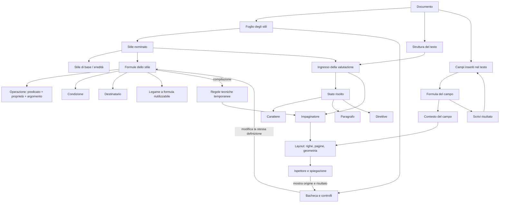
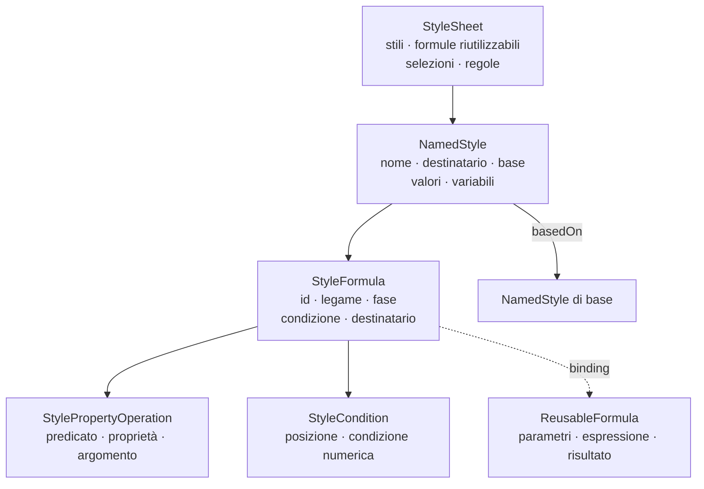
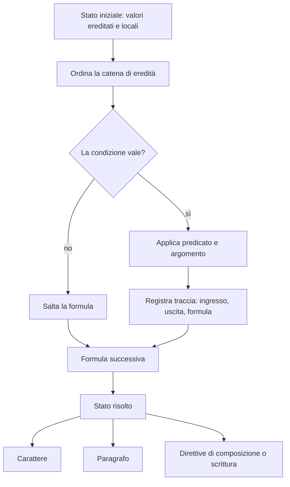
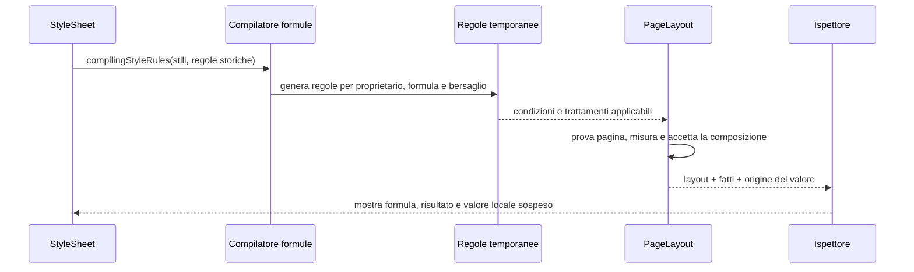
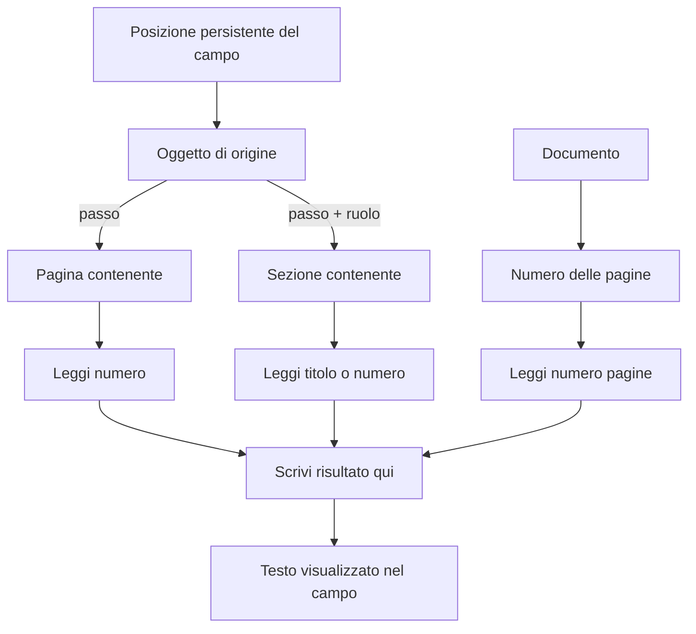
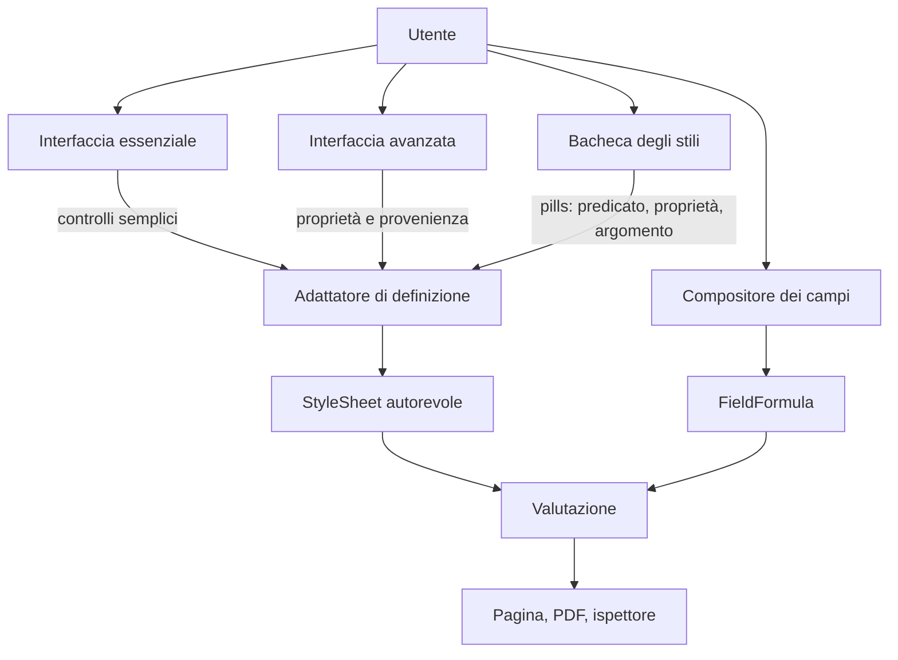

# Schema del modello: stili, formule, campi e composizione

Questo documento è la mappa unica del modello attuale. Le frecce piene indicano dati o chiamate già presenti nel fork; le frecce tratteggiate indicano risultati temporanei della composizione o estensioni ancora progettuali.

## 1. Vista d'insieme



Il punto centrale è la distinzione fra definizione e risultato. Lo stile conserva formule e intenzioni; la valutazione produce uno stato tipografico; la composizione produce pagine e geometria. Il risultato composto non diventa automaticamente una nuova definizione dello stile.

## 2. Che cosa contiene uno stile



Una formula dello stile è una dichiarazione tipizzata, non una stringa libera. Il predicato non è la proprietà: `Imposta`, `Aggiungi` e `Sottrai` sono predicati; `Font`, `Corpo`, `Spazio prima`, `Allineamento` e le direttive sono proprietà o argomenti della proprietà.

Esempi:

```text
[Questo paragrafo] → [Imposta] [Corpo] [12 pt]
[Caratteri contenuti] → [Aggiungi] [Font] [Grassetto]
[Questo paragrafo] → [Sottrai] [Spazio prima] [6 pt]
[Quando primo della pagina] → [Imposta] [Distanza a inizio pagina] [30 mm]
[Dopo Invio] → [Imposta] [Stile successivo] [Testo]
```

`Imposta` sostituisce il valore della proprietà. `Aggiungi` e `Sottrai` leggono lo stato ricevuto e lo trasformano: corsivo + grassetto diventa grassetto corsivo; grassetto corsivo − grassetto diventa corsivo.

## 3. Valutazione di uno stile



Le formule vengono rivalutate sullo stesso ingresso quando cambiano testo, stile, contesto o impaginazione. La condizione può leggere il contesto del paragrafo (`primo della pagina`, `dopo uno stile`, `inizio sequenza`) oppure fatti naturali (`numero di parole`, righe, riempimento dell'ultima riga, righe sillabate).

Le fasi già codificate separano:

| Fase | Legge o produce |
|---|---|
| `base` | font, corpo, allineamento, rientri e valori ordinari |
| `textContext` | proprietà dipendenti dal testo o dal destinatario |
| `placement` | apertura, tenuta, vedove/orfane e distanza a inizio pagina |
| `composition` | bersagli come parole, righe o porzioni composte |
| `assignment` | apertura di sezione e livello del titolo |
| `paragraphCreation` | stile da usare dopo Invio |

## 4. Dal modello all'impaginatore

Le formule contestuali dello stile non vengono salvate come stili tecnici separati. Durante la composizione vengono compilate in regole temporanee compatibili con il motore esistente:



Le regole storiche restano leggibili. Le regole tecniche generate hanno identità temporanee e non entrano nel file dell'autore; il file conserva la formula nello stile.

## 5. Campi: formule che vivono nel testo

Un campo è diverso da una formula dello stile per durata e proprietario:



Le catene attualmente previste sono:

```text
Posizione → Pagina contenente → Numero → Scrivi risultato qui
Posizione → Sezione contenente (ruolo) → Titolo → Scrivi risultato qui
Posizione → Sezione contenente (ruolo) → Numero → Scrivi risultato qui
Documento → Numero delle pagine → Scrivi risultato qui
```

Il carattere del campo conserva nel documento la formula, non il numero calcolato. Quando il testo precedente cambia, il punto si sposta con il testo; quando cambia la paginazione, il valore viene ricalcolato. Il campo viene visualizzato con lo stile del tratto che lo contiene.

## 6. Stili, campi e interfaccia



La GUI semplice non crea una seconda versione dello stile. Cambiare il corpo dal controllo ordinario e cambiare la pill `Imposta · Corpo · 12 pt` sono due modi di modificare la stessa formula, quando la formula è rappresentabile dal controllo. Se il valore deriva da una formula più complessa, il controllo mostra la provenienza e richiede una sostituzione esplicita prima di trasformarla in un valore fisso.

## 7. Confini attuali del modello

Già presenti nel fork: formule degli stili, eredità, `Imposta/Aggiungi/Sottrai`, condizioni contestuali, destinatari, formule riutilizzabili con variabili e parametri, bacheca, traccia dei risultati, campi con catene `Posizione`/`Documento` e `Scrivi risultato`, testate di capitolo con parti composte, composizione delle regole e spiegazione nell'ispettore.

Restano da ampliare: il catalogo degli oggetti e dei predicati, i flottanti derivati come la nota marginale della quinta parola, le formule complete per tabelle e flottanti, i rimandi a oggetti precisi e le relazioni più ricche fra oggetti vicini. Restano inoltre le verifiche d'uso a schermo e la successiva riduzione della retrocompatibilità. Queste estensioni dovranno riusare la stessa separazione fra definizione, valutazione, composizione e risultato visualizzato.
